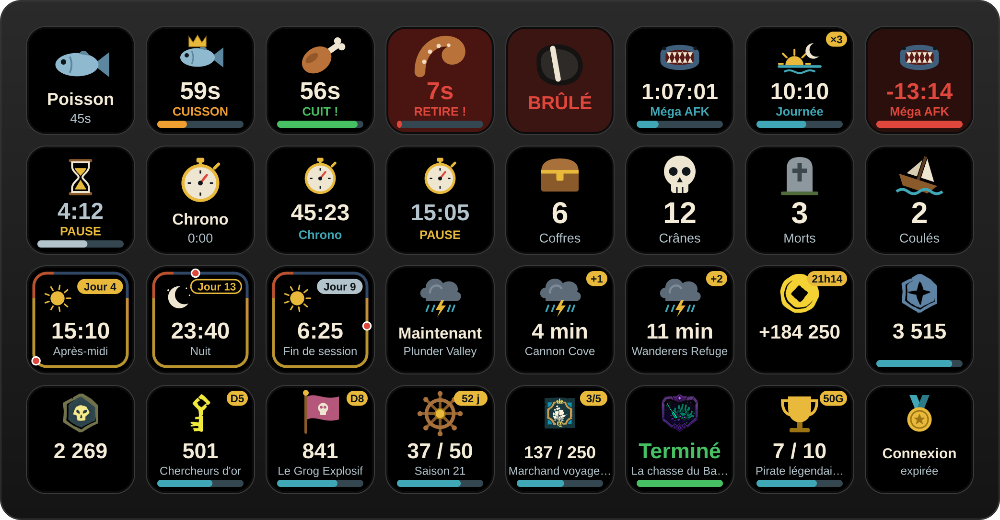

# Stream Deck – Sea of Thieves

Plugin Stream Deck pour Sea of Thieves (bêta).

👉 **[Page de présentation, téléchargement et guide](https://powange.github.io/streamdeck-sot/)**



## Installation

1. Télécharge [com.powange.seaofthieves.streamDeckPlugin](https://github.com/powange/streamdeck-sot/releases/latest/download/com.powange.seaofthieves.streamDeckPlugin) (dernière version).
2. Double-clique sur le fichier : Stream Deck l'installe (ou le met à jour).

Prérequis : Stream Deck 7.1 ou plus récent, sous Windows.

## Actions

- **Minuteur de cuisson** : appuie quand la nourriture est posée sur le feu. Le bouton décompte jusqu'à la cuisson, passe au vert, puis clignote en rouge 10 s avant que ça brûle. Un nouvel appui arrête le minuteur.
  Aliments : poisson, poisson trophée, poulet, porc, serpent, requin, kraken, mégalodon. Les temps peuvent être modifiés dans les réglages du bouton.
- **Minuteur** : minuteurs de jeu, avec préréglages Mégalodon AFK (1h30) et Journée en jeu (24 min, en boucle), ou durée personnalisée. Appui court : démarrer / pause / reprendre, appui long : remise à zéro. Le minuteur continue même si Stream Deck redémarre. Une fois terminé (sans répétition), il compte le temps écoulé en négatif ; en boucle, il affiche le nombre de répétitions (×3).
- **Chronomètre** : appui court : démarrer / pause / reprendre, appui long : remise à zéro.
- **Sons** (minuteurs de cuisson et de jeu, Windows) : cloche quand c'est cuit ou à chaque nouvelle journée, bips 10 s avant que ça brûle ou 1 min avant la fin d'un minuteur, triple cloche quand c'est brûlé ou terminé. Désactivables par bouton ; le son de fin peut être remplacé par un fichier `.wav`.
- **Tempête** : île sous la tempête, ou l'une des 5 suivantes, et dans combien de temps la tempête l'atteint. Prévisions de [Merfolk's Lullaby](https://www.merfolkslullaby.com/map?tab=weather), actualisées toutes les 24 minutes (comme leur carte) et seulement quand un bouton Tempête est affiché.
- **Heure en jeu** : heure, moment de la journée (lever du soleil, matin, après-midi, coucher du soleil, nuit) et jour du cycle de 30 jours. Calculée localement à partir de l'heure réelle (une journée = 24 minutes), selon la même formule que la carte de Merfolk's Lullaby. Le contour du bouton sert d'horloge (point rouge). Compteur de jours en jeu : appui court pour démarrer une session, appui long pour remettre à zéro ; à la fermeture du jeu, il s'arrête et reste affiché jusqu'à la session suivante.
- **Compteur de session** : appui court = +1, appui long = remise à zéro. Icônes : coffre, crâne, mort, navire coulé, autre.
- **Commendation** : affiche la progression d'une commendation de ton profil pirate [seaofthieves.com](https://www.seaofthieves.com/profile/reputation) (grade, valeur / seuil, image). Choix en cascade : faction → campagne → commendation. Appuie pour actualiser.
- **Niveau de faction** : niveau d'une compagnie, d'une faction (Gardiens de la fortune, Serviteurs de la flamme) ou d'une guilde, avec la distinction et la progression vers le niveau suivant. Même token RAT que les commendations.
- **Bourse** : or, doublons (avec le plafond) ou pièces anciennes du profil. En mode « Gains de la session », un appui long démarre une session et le bouton affiche le gain depuis ce moment (+184 250), avec l'heure de départ. En mode « Gains depuis le lancement du jeu », la session redémarre automatiquement à chaque lancement de Sea of Thieves (`SoTGame.exe`), pour tous les boutons Bourse à la fois.
- **Saison** : niveau de renommée atteint dans la saison en cours (sur 50), avec les jours restants avant la fin de la saison.
- **Succès Xbox** : affiche la progression d'un succès Xbox de Sea of Thieves via [OpenXBL](https://xbl.io). Appuie pour actualiser.

### Titre et disposition

- Le **titre** saisi dans le champ « Titre » de Stream Deck s'affiche dans le dessin du bouton, à la place du libellé par défaut (nom de l'aliment, du minuteur, du compteur, de la commendation…).
- La case **« Texte en haut, image en bas »** des réglages de chaque bouton inverse la disposition.

### Connexion au profil seaofthieves.com

Rare ne fournit pas d'API publique : le plugin utilise l'API interne du site (`/fr/api/profilev2/reputation`), authentifiée par le cookie `rat` de ta session.

1. Connecte-toi sur www.seaofthieves.com.
2. F12 → **Application** → **Cookies** → `https://www.seaofthieves.com` → copie la valeur du cookie `rat`.
3. Colle-la dans le champ « Token RAT » des réglages d'un bouton Commendation (elle est partagée par tous les boutons).

Le site renvoie un token renouvelé à chaque actualisation : le plugin l'enregistre automatiquement à la place de l'ancien, et l'heure du dernier renouvellement s'affiche sous le champ « Token RAT ». Le token est chiffré, sa date d'expiration est donc illisible ; s'il finit par expirer, les boutons affichent « Connexion expirée » : un appui sur l'un d'eux ouvre une fenêtre avec un lien vers seaofthieves.com et un champ pour coller le nouveau cookie (un bouton « Ouvrir seaofthieves.com » est aussi dans les réglages). Il donne accès à ton compte sur le site : ne le partage pas. Il est stocké localement par Stream Deck.

### Connexion Xbox (OpenXBL)

Crée une clé API sur [xbl.io](https://xbl.io) (connexion avec ton compte Microsoft) et colle-la dans le champ « Clé OpenXBL ». L'offre gratuite est limitée à ~150 requêtes / heure : les succès sont mis en cache 10 minutes.

## Développement

Prérequis : Node.js 24, Stream Deck 7.1+ (Windows).

```bash
npm install
npm run build        # compile vers com.powange.seaofthieves.sdPlugin/bin
npm run validate     # valide le manifest
npm run deploy:win   # depuis WSL : build, copie dans le Stream Deck Windows et redémarre l'appli
npm run pack         # génère le fichier .streamDeckPlugin
```

Sous Windows directement, `npx streamdeck link com.powange.seaofthieves.sdPlugin` puis `npm run watch` pour le rechargement à chaud.

Les logs du plugin sont dans `com.powange.seaofthieves.sdPlugin/logs/` (dans le dossier des plugins Stream Deck : `%APPDATA%\Elgato\StreamDeck\Plugins\`).

Les sons de `com.powange.seaofthieves.sdPlugin/sounds/` sont synthétisés par `node scripts/generate-sounds.mjs`.

### Publier une version

Pousser un tag `vX.Y.Z` déclenche le workflow [release.yml](.github/workflows/release.yml), qui construit le plugin et publie une release GitHub avec le fichier `.streamDeckPlugin` :

```bash
npm version 0.2.0      # met à jour package.json, commite et crée le tag v0.2.0
git push --follow-tags
```

## Temps de cuisson

Temps depuis la pose sur le feu (cuit / brûlé), valeur « cuit » la plus prudente entre
[sotfr.net](https://sotfr.net/guides/gameplay/guide-peche-chasse/) et le [wiki](https://seaofthieves.wiki.gg/wiki/Cooking) :

| Nourriture | Cuit | Brûlé |
| --- | --- | --- |
| Poisson | 45 s | 80 s |
| Poisson trophée | 90 s | 180 s |
| Viandes (poulet, porc, serpent, requin) | 60 s | 120 s |
| Kraken, mégalodon | 120 s | 240 s |

## Mentions

Plugin non officiel, gratuit, créé par un fan. Les icônes des monnaies proviennent du site seaofthieves.com, celles des factions du [wiki Sea of Thieves](https://seaofthieves.wiki.gg/wiki/Trading_Companies).
Sea of Thieves © Microsoft Corporation. Ce plugin a été créé dans le cadre des [règles d'utilisation du contenu de jeu de Microsoft](https://www.xbox.com/fr-FR/developers/rules) à l'aide de ressources de Sea of Thieves ; il n'est ni approuvé par Microsoft ni affilié à Microsoft.
